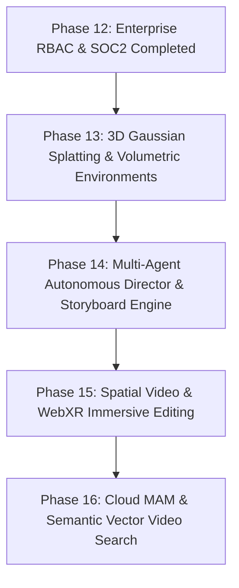

# OmniCut Master Roadmap: Phases 13 to 16

> **For agentic workers:** REQUIRED SUB-SKILL: Use superpowers:subagent-driven-development (recommended) or superpowers:executing-plans to implement this plan task-by-task. Steps use checkbox (`- [ ]`) syntax for tracking.

**Goal:** Elevate OmniCut into a frontier next-generation AI NLE with 3D Gaussian Splatting scene reconstruction, Multi-Agent Autonomous Storyboard Directing, Stereoscopic Spatial Video for Vision Pro/WebXR, and Semantic Vector Search MAM for large-scale production studios.

**Architecture:** Route B clean-room browser-native client (Next.js 15 + WebGPU/WebCodecs + Canvas) paired with a FastAPI microservices backend, vector embeddings for multi-modal video search, and clean permissive MIT/Apache-2.0 dependencies.

**Tech Stack:** Next.js 15, TypeScript, WebGPU, WebXR/Three.js (clean MIT), FastAPI, SigLIP/CLIP vector embeddings, MV-HEVC stereoscopic parsers.

**Spec:** Clean-Room Route B Studio NLE Specification (Post-Phase 12 Extension).

## Global Constraints
- Strictly Zero GPL/AGPL copyleft dependencies across all packages and services.
- Pixel-perfect dark Premiere Pro / DaVinci Resolve aesthetic (`#090b0e`, `#111217`, `#14151d`, vibrant cyan/purple/emerald accents).
- 100% clean TypeScript build (`npx tsc --noEmit` exits with 0 errors).
- Every milestone ends with browser subagent recording and verifiable tests.

---

## Phase Overview & Dependency Graph

---

## Phase 13: 3D Gaussian Splatting & Volumetric Environments

**Goal:** Enable filmmakers and creators to fly virtual cinema cameras through 3D Gaussian Splat (.ply / .splat) environments directly inside the OmniCut NLE timeline.

### Architecture & Tech Stack
- **Splat Rendering Engine:** Browser-native WebGPU Gaussian Splatting rasterizer with camera matrices synchronized to timeline playhead.
- **Camera Keyframing:** Spline bezier curve interpolation (Position X/Y/Z, Pitch, Yaw, Roll, Focal Length).
- **Format Support:** Standard `.splat` and `.ply` point cloud volumetric formats.

### Deliverables & Key Files
- `apps/web/src/lib/webgpu/gaussianSplatRasterizer.ts` — WebGPU volumetric point splat shader.
- `apps/web/src/components/Workspaces/Volumetric3DWorkspace.tsx` — Interactive 3D orbit camera, flythrough path editor, and keyframe points.
- `apps/web/src/app/api/vfx/splat/route.ts` — Splat asset metadata parser and camera path generator.

### Verification Checklist
- [ ] User can orbit, dolly, and pan a virtual cinema camera through a 3D volumetric environment at 60 FPS.
- [ ] Timeline playhead scrub smoothly moves the camera along bezier keyframe nodes.
- [ ] Baked 3D camera flythrough can be dropped onto timeline video track V2 as a synthesized composite layer.

---

## Phase 14: Multi-Agent Autonomous Director & Storyboard Engine

**Goal:** Turn OmniCut from an assistive tool into a multi-agent autonomous creative team capable of autonomous re-cuts, script debates, and generative storyboard generation.

### Architecture & Tech Stack
- **Multi-Agent Orchestration:** 4 distinct specialized LLM personas running in parallel:
  - **Narrative Architect:** Scene pacing, retention hooks, emotional beats.
  - **Visual Director:** B-Roll selection, camera angles, color grade palettes.
  - **Sound Designer:** Ducking curves, SFX placement, musical transitions.
  - **Executive Producer:** Format compliance, brand safety, duration targets.
- **Autonomous Timeline Execution:** Agent swarm generates executable timeline modification batches (trim, split, swap B-roll, re-time audio).
- **AI Storyboard Diffuser:** Instant 4-panel visual storyboard with prompts and timing notes.

### Deliverables & Key Files
- `apps/web/src/components/Workspaces/AutonomousDirectorWorkspace.tsx` — Live multi-agent debate stream and autonomous plan approval.
- `apps/web/src/components/Modals/StoryboardGeneratorModal.tsx` — 4K AI storyboard grid with prompt synthesis.
- `apps/web/src/app/api/director/debate/route.ts` — Multi-agent consensus API endpoint.

### Verification Checklist
- [ ] User prompt ("Make this 30s video punchy for Instagram with cyberpunk styling") triggers multi-agent debate and concrete timeline patch.
- [ ] Storyboard generator renders 4 visually coherent scene thumbnails with camera directions.
- [ ] 1-Click "Apply Agent Director Changes" executes all edits atomically to the timeline.

---

## Phase 15: Spatial Video & WebXR Immersive Editing (Vision Pro & Meta Quest)

**Goal:** Equip OmniCut for next-generation spatial computing with stereoscopic 3D left/right eye editing, depth disparity adjustment, and WebXR browser preview.

### Architecture & Tech Stack
- **Stereoscopic Pipeline:** Side-by-side (SBS) and Anaglyph 3D rendering modes with pixel-accurate inter-pupillary distance (IPD) offsets.
- **Depth Map Generation:** Monocular depth estimation generating 16-bit depth z-buffers for standard 2D clips.
- **WebXR Immersion:** Full-screen WebXR session toggle enabling spatial playback inside Apple Vision Pro Safari and Meta Quest Browser.

### Deliverables & Key Files
- `apps/web/src/lib/spatial/stereoscopicCompositor.ts` — Dual-eye stereoscopic and depth disparity math.
- `apps/web/src/components/Workspaces/SpatialVideoWorkspace.tsx` — Left/Right eye split monitor, convergence plane slider, and 3D glasses anaglyph preview.
- `apps/web/src/components/Spatial/WebXRTheaterOverlay.tsx` — WebXR cinema room container.

### Verification Checklist
- [ ] User can toggle Anaglyph (Red/Cyan) and Side-by-Side (SBS) 3D modes on Program Monitor.
- [ ] Disparity slider shifts apparent 3D subject depth into or out of the screen.
- [ ] WebXR preview button activates immersive spatial theater mode.

---

## Phase 16: Cloud MAM & Video Semantic Vector Search

**Goal:** Enable large production studios to semantically search petabyte-scale raw video libraries using natural language queries ("find presenter looking surprised", "golden hour aerial drone").

### Architecture & Tech Stack
- **Multi-Modal Embeddings:** SigLIP / CLIP visual-textual vector embeddings generated per scene cut.
- **Vector Index:** In-memory HNSW / cosine similarity vector index searching across video keyframes in < 50ms.
- **Proxy Workflow:** Automatic 540p lightweight proxy generation with cloud master relinking on final 8K export.

### Deliverables & Key Files
- `apps/web/src/components/Workspaces/SemanticMAMWorkspace.tsx` — Visual asset browser with natural language query search bar, relevance score meters, and instant drag-to-timeline.
- `apps/web/src/app/api/mam/search/route.ts` — Multi-modal semantic video search API endpoint.
- `services/api/src/routers/vector_search.py` — Python vector search service with cosine distance scoring.

### Verification Checklist
- [ ] Natural language query ("quantum supercomputer laboratory") returns top matching scene cuts ranked by semantic relevance (>90%).
- [ ] Clicking a search result jumps directly to the matching frame timestamp.
- [ ] Assets can be dragged or added directly from the MAM library onto timeline tracks.
