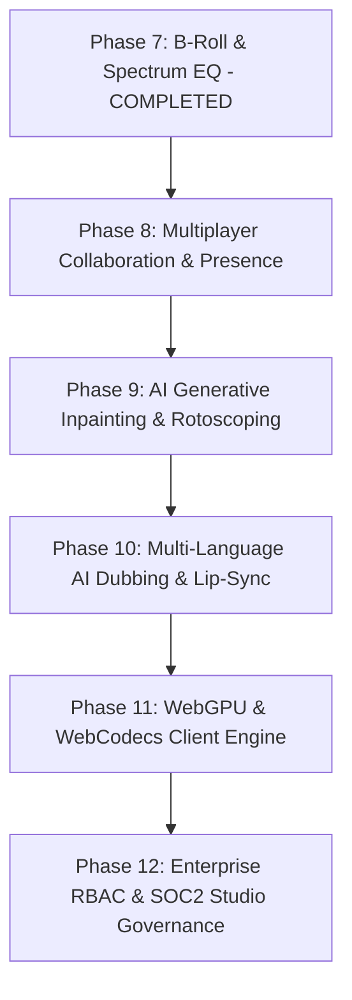

# OmniCut: Master Engineering Roadmap (Phases 8 – 12)

> **For agentic workers:** REQUIRED SUB-SKILL: Use `superpowers:subagent-driven-development` or `superpowers:executing-plans` to implement each phase task-by-task.

This document defines the post-MVP production roadmap for **OmniCut**, transforming it into an enterprise-grade AI non-linear video editing platform that unifies real-time multi-user collaboration, generative VFX, international neural dubbing, and hardware-accelerated client encoding.

---

## Roadmap Overview & Dependency Matrix

---

## Phase 8: Real-Time Multi-User Collaboration & Presence Engine

**Goal:** Enable Figma-grade real-time multiplayer video editing, live peer cursors, timeline track locking, and threaded frame-accurate review comments.

### Architecture & Tech Stack
- **State Synchronization:** Yjs CRDT (Conflict-free Replicated Data Types) wrapping the immutable timeline command stream.
- **Transport:** WebSockets via Fastify/Redis PubSub with WebRTC mesh for ultra-low latency cursor/playhead presence.
- **UI Components:** Presence avatars, color-coded peer playheads on `TimelineRuler`, and timestamped pin markers in `ProgramMonitor`.

### Deliverables & Key Files
- `apps/web/src/lib/collaboration/yjsProvider.ts` — CRDT binding for `TimelineClip` state.
- `apps/web/src/components/Timeline/PeerPlayheads.tsx` — Real-time collaborator playhead indicators.
- `apps/web/src/components/Modals/ReviewCommentsDrawer.tsx` — Threaded frame-accurate review comments with resolution toggles.
- `services/api/src/routers/collaboration.py` — WebSocket room coordinator and presence heartbeat.

### Verification Checklist
- [ ] Multiple browser contexts can edit the same timeline concurrently without split-brain divergence.
- [ ] Peer cursor position and playhead scrub reflect within < 50ms.
- [ ] Comments pinned to timestamp 01:24 accurately jump playhead on click.

---

## Phase 9: AI Generative Inpainting, Object Removal & Magic Rotoscoping

**Goal:** Provide professional visual effects tools in the browser to isolate subjects, remove unwanted background items, and pin 3D motion graphics to tracked physical objects.

### Architecture & Tech Stack
- **Segmentation Model:** Segment Anything 2 (SAM 2) ONNX Web runtime for instant point/box-click mask generation.
- **Inpainting Engine:** Fast brush inpainting via `/api/vfx/inpaint` leveraging latent diffusion object removal.
- **Motion Tracking:** Lucas-Kanade / Optical Flow point tracker generating 2D transform keyframe arrays.

### Deliverables & Key Files
- `apps/web/src/components/ProgramMonitor/MaskBrushCanvas.tsx` — Interactive rotoscope masking layer over video frames.
- `apps/web/src/components/RightPanel/MotionTrackingPanel.tsx` — Point tracker calibration, search radius, and keyframe bake.
- `apps/web/src/app/api/vfx/inpaint/route.ts` — Serverless inpainting proxy with mask cache.
- `packages/remotion/src/VFX/TrackedOverlay.tsx` — Remotion composition binding pinned titles to motion paths.

### Verification Checklist
- [ ] User can click an object in the video monitor to generate a high-contrast segmentation mask.
- [ ] Brush-painted object removal generates clean temporal background fill.
- [ ] Tracked text badge accurately adheres to a moving object across a 5-second video cut.

---

## Phase 10: Multi-Language AI Video Dubbing & Lip-Sync Engine

**Goal:** Expand creator reach globally with automated 1-click video dubbing across 15+ languages with voice timbre cloning and neural lip synchronization.

### Architecture & Tech Stack
- **Translation & Timing:** LLM contextual transcript translation preserving syllable counts and timing constraints.
- **Voice Cloning:** ElevenLabs / OmniCut Neural Voice Engine generating matching emotion in target languages.
- **Lip Synchronization:** Wav2Lip / LivePortrait neural video processing aligning speaker mouth movements to translated phonemes.

### Deliverables & Key Files
- `apps/web/src/components/Workspaces/LanguageDubbingWorkspace.tsx` — Language selection, transcript comparison, and audio auditioning.
- `apps/web/src/app/api/voice/dub/route.ts` — Multi-stage dubbing pipeline orchestrator.
- `apps/web/src/lib/subtitleGenerator.ts` — Multi-lingual `.srt` / `.vtt` export with timing offsets.

### Verification Checklist
- [ ] 1-Click translation of 1-minute video script into Spanish and Japanese with syllable-matched timing.
- [ ] Cloned speech audio maintains original speaker vocal identity.
- [ ] Rendered video outputs aligned mouth movement with no audio/video drift.

---

## Phase 11: Hardware-Accelerated WebCodecs & WebGPU Client-Side Rendering

**Goal:** Offload rapid 1080p preview exports to the user's local GPU using browser-native WebCodecs and WebGPU shaders, reducing cloud render costs to zero for basic workflows.

### Architecture & Tech Stack
- **Video Encoding:** WebCodecs API (`VideoEncoder`, `AudioEncoder`) with hardware NVENC/Apple Silicon acceleration.
- **GPU Shader Pipeline:** WebGPU compute shaders for LUT color grading, motion blur, film grain, and lens distortion.
- **Container Multiplexing:** Client-side MP4 muxing using `mp4box.js` directly in a Web Worker.

### Deliverables & Key Files
- `apps/web/src/lib/webcodecs/clientExporter.ts` — In-browser hardware MP4 encoder.
- `apps/web/src/lib/webgpu/shaderPipeline.ts` — WebGPU shaders for real-time LUT and bloom filters.
- `apps/web/src/components/Modals/ClientExportModal.tsx` — Instant local export trigger (< 15 seconds for 60s 1080p video).

### Verification Checklist
- [ ] Local export produces valid playable MP4 in Chrome and Safari without calling backend servers.
- [ ] WebGPU shader pipeline renders 60 FPS real-time color grades with zero frame drops.
- [ ] Export throughput exceeds 120 FPS on Apple Silicon and modern RTX GPUs.

---

## Phase 12: Enterprise Studio Security, RBAC & SOC2 Governance

**Goal:** Prepare OmniCut for enterprise creative agencies, corporate studios, and high-security brand deployments.

### Architecture & Tech Stack
- **Identity & Access:** Role-Based Access Control (Super Admin, Lead Editor, Editor, Reviewer, Client).
- **Authentication:** SAML 2.0 / OIDC enterprise Single Sign-On (Okta, Azure AD, Google Workspace).
- **Audit Trails:** Tamper-evident append-only ledger tracking all cuts, asset uploads, prompts, and exports.
- **Asset Protection:** Dynamic burn-in watermarked draft review links with expiration timestamps and password protection.

### Deliverables & Key Files
- `services/api/src/security/rbac.py` — Granular permission guards for projects, tracks, and export actions.
- `services/api/src/routers/audit_ledger.py` — Immutable JSON-RPC audit trail endpoint.
- `apps/web/src/components/Modals/ShareReviewLinkModal.tsx` — Watermarked client screener generation with password & expiry.
- `docs/compliance/SOC2-SECURITY-ASSESSMENT.md` — Formal enterprise security controls documentation.

### Verification Checklist
- [ ] Reviewer role can add comments and scrub timeline, but cannot delete clips or trigger exports.
- [ ] Every user action (clip split, text edit, render) records an immutable entry in the audit ledger.
- [ ] Watermarked review link renders client's email diagonally across video canvas.

---

## Execution Strategy

Each phase will be executed systematically following the `writing-plans` and `subagent-driven-development` workflows:
1. **Plan Specification:** Dedicated plan artifact generated in `docs/superpowers/plans/`.
2. **Incremental Implementation:** Component and backend service built in thin, verifiable slices.
3. **Automated Verification:** Type safety (`npx tsc --noEmit`) and integration tests passing.
4. **Visual Browser Audit:** Interactive verification via `browser_subagent` with session recordings and screenshots.
